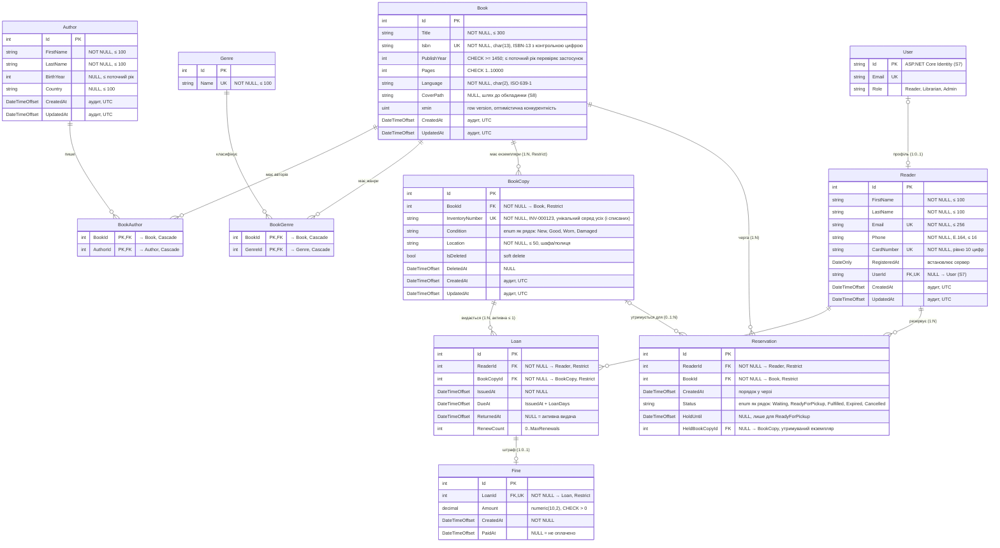

# ERD — Library Management API

Діаграма предметної області (Entity-Relationship Diagram). Джерела: [TZ.md](TZ.md), REST-контракти S2 (#7, #9, #11, #13, #15), зв'язки S4 (#31–#33, #45), бізнес-логіка S5 (#50, #52), авторизація S7 (#66).
Діаграму оновлюють у кожній задачі, що змінює модель даних.

## Кардинальність

| Зв'язок | Тип | Видалення батька |
|---|---|---|
| Book — Author | M:N через `BookAuthor` | Cascade (зникає лише запис зв'язку) |
| Book — Genre | M:N через `BookGenre` | Cascade (зникає лише запис зв'язку) |
| Book — BookCopy | 1:N | **Restrict**: не можна видалити книгу з екземплярами |
| Reader — Loan | 1:N | Restrict |
| BookCopy — Loan | 1:N (історія), активна — не більше 1 | Restrict |
| Loan — Fine | 1:0..1 | Restrict |
| Reader — Reservation | 1:N | Restrict |
| Book — Reservation | 1:N (черга на книгу) | Restrict |
| BookCopy — Reservation | 0..1:N (утримання) | SetNull |
| User — Reader | 0..1:0..1 (у читача може не бути облікового запису) | Restrict |

## Неочевидні рішення

- **Book і BookCopy — різні сутності.** Каталог описує видання (назва, ISBN), а видаються конкретні фізичні екземпляри з власним інвентарним номером і станом. Тому `Loan` посилається на `BookCopy`, а не на `Book`.
- **M:N без додаткових даних (`BookAuthor`, `BookGenre`)** — це join-таблиці зі складеним PK `(BookId, AuthorId)` / `(BookId, GenreId)`, тому одна пара не може повторитися. Книга без авторів допустима (немає жодного рядка в `BookAuthor`).
- **Loan — окрема сутність, а не M:N Reader–BookCopy**, бо несе власні дані: дати видачі, терміну, повернення й кількість продовжень. Один екземпляр має багато видач в історії, але **активна (ReturnedAt IS NULL) — не більше однієї**. Це гарантує частковий унікальний індекс `UNIQUE (BookCopyId) WHERE ReturnedAt IS NULL`.
- **Fine — 1:0..1 до Loan.** Штраф створюється лише при поверненні після `DueAt`, тому `LoanId` унікальний. Сума — `decimal` (`numeric(10,2)`), а не `double`, щоб не було похибок округлення грошей. Ставка (`FinePerDay`) береться з конфігурації і в БД не зберігається.
- **Reservation посилається на Book, а не на BookCopy**: читачу підходить будь-який вільний екземпляр. Коли екземпляр повертають, перший резерв у черзі переходить у `ReadyForPickup`, а в `HeldBookCopyId` записується утримуваний екземпляр. Так можна заборонити видачу цього екземпляра іншому читачу. Позиція в черзі обчислюється за `CreatedAt` серед резервів у статусі `Waiting` і не зберігається.
- **Один активний резерв на книгу для читача**: частковий унікальний індекс `UNIQUE (ReaderId, BookId) WHERE Status IN ('Waiting', 'ReadyForPickup')`.
- **Soft delete для BookCopy.** Списаний екземпляр лишається в БД (на нього посилаються історичні видачі). Глобальний query filter ховає записи з `IsDeleted = true`. Унікальність `InventoryNumber` діє серед **усіх** екземплярів, включно зі списаними: звичайний `UNIQUE` без фільтра. Інакше номер списаного екземпляра можна було б видати новому, і в історії видач два різні екземпляри мали б однаковий номер.
- **Конкурентність Book** — через системний стовпець PostgreSQL `xmin` (`IsRowVersion`), тому окремий стовпець версії не потрібен.
- **Enum-и** (`Condition`, `Status`) зберігаються як рядки (`HasConversion<string>()`), щоб дані в БД були читабельні й не ламалися при зміні порядку значень enum.
- **Сурогатні ключі `int Id`** використано всюди, навіть де є природний унікальний ключ (ISBN, CardNumber). Такий ключ стабільний, коли природне значення виправляють, і робить JOIN дешевшими.
- **Час** зберігається як `DateTimeOffset` в UTC (`timestamptz`) і береться з `TimeProvider`, щоб у тестах можна було підставити `FakeTimeProvider`. `RegisteredAt` — `DateOnly` (`date`), бо час доби там не потрібен.
- **User** з'являється в S7 (ASP.NET Core Identity). Ролі зберігаються в таблицях Identity, на діаграмі вони спрощено показані полем `Role`.

## Обмеження (індекси й CHECK)

| Таблиця | Обмеження |
|---|---|
| Genre | `UNIQUE (Name)` |
| Book | `UNIQUE (Isbn)`, `CHECK (Pages BETWEEN 1 AND 10000)`, `CHECK (PublishYear >= 1450)` |
| BookCopy | `UNIQUE (InventoryNumber)` (без фільтра, включно зі списаними) |
| Reader | `UNIQUE (Email)`, `UNIQUE (CardNumber)`, `UNIQUE (UserId)` |
| Loan | `UNIQUE (BookCopyId) WHERE ReturnedAt IS NULL`, `CHECK (DueAt > IssuedAt)` |
| Fine | `UNIQUE (LoanId)`, `CHECK (Amount > 0)` |
| Reservation | `UNIQUE (ReaderId, BookId) WHERE Status IN ('Waiting','ReadyForPickup')` |
